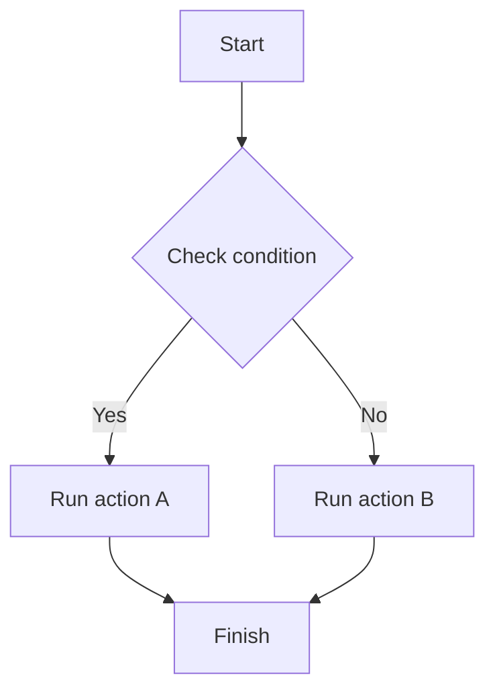
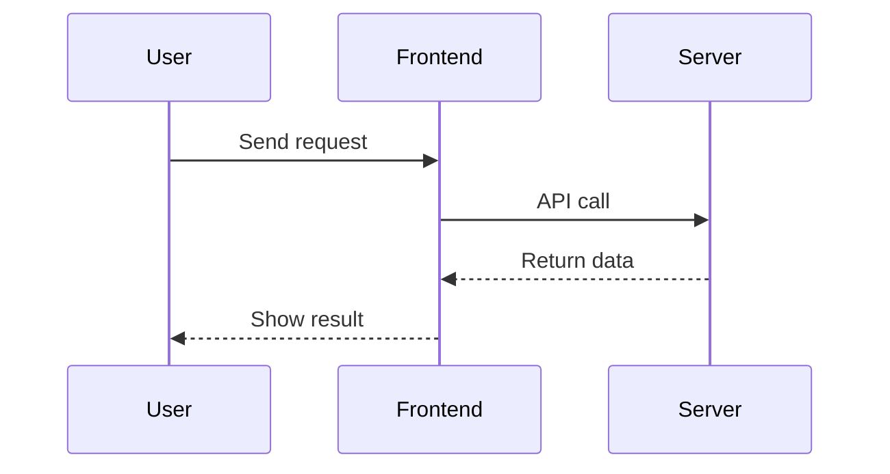
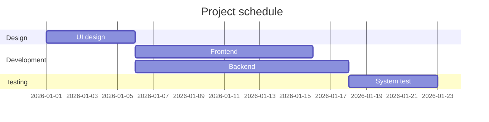
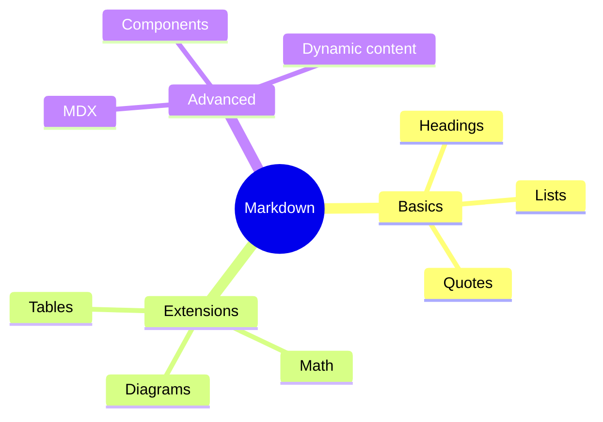
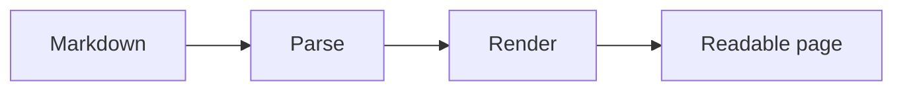

# Heading One (H1)
## Heading Two (H2)
### Heading Three (H3)
#### Heading Four (H4)
##### Heading Five (H5)
###### Heading Six (H6)

---

## 1. Text Formatting

Regular paragraph text.

**Bold text**

*Italic text*

***Bold italic text***

~~Strikethrough~~

<u>Underlined text</u>

==Highlighted text==

`Inline code`

H~2~O

X^2^

Superscript: <sup>2</sup>

Subscript: <sub>2</sub>

Keyboard shortcut: <kbd>Ctrl</kbd> + <kbd>C</kbd>

---

## 2. Blockquotes

> A regular quote.

> First level quote
>> Second level quote
>>> Third level quote

---

## 3. Lists

- Unordered item
- Second item
  - Nested item A
  - Nested item B

1. First step
2. Second step
3. Third step

### Task List

- [x] Completed
- [x] Reviewed
- [ ] In progress
- [ ] Ready to publish

---

## 4. Links

[OpenAI](https://openai.com)

<https://example.com>

[Link with a title](https://example.com "Tooltip text")

---

## 5. Images


<figure class="article-figure">
  <a href="https://images.unsplash.com/photo-1498050108023-c5249f4df085?auto=format&amp;fit=crop&amp;w=1800&amp;q=90">
    
  </a>
  <figcaption>A quiet workstation</figcaption>
</figure>

---

## 6. Tables

| Name | Type | Status |
|:---|:---:|---:|
| Markdown | Document | ✅ |
| Mermaid | Diagram | ✅ |
| MDX | Component | 🚀 |

---

## 7. Code Blocks

```python
def hello(name):
    return f"Hello, {name}!"

print(hello("World"))
```

```javascript
const user = {
  name: "Alice",
  age: 20,
  active: true
};

console.log(user);
```

```json
{
  "name": "Markdown",
  "version": "1.0",
  "enabled": true
}
```

```diff
- const oldValue = 10;
+ const newValue = 20;
```

---

## 8. Math

Inline formula: $E = mc^2$

Block formula:

$$
E = mc^2
$$

Integral:

$$
\int_{-\infty}^{+\infty} e^{-x^2} dx
= \sqrt{\pi}
$$

Matrix:

$$
A =
\begin{bmatrix}
1 & 2 & 3 \\
4 & 5 & 6 \\
7 & 8 & 9
\end{bmatrix}
$$

---

## 9. Mermaid Flowchart



---

## 10. Mermaid Sequence Diagram



---

## 11. Mermaid Gantt Chart



---

## 12. Mermaid Mind Map



---

## 13. GitHub-Style Alerts

> [!NOTE]
> A note with useful context.

> [!TIP]
> A practical tip.

> [!IMPORTANT]
> An important detail.

> [!WARNING]
> A warning.

> [!CAUTION]
> A reminder before a risky action.

---

## 14. Collapsible Section (HTML)

<details>
<summary>Click to expand</summary>

This content is hidden until expanded.

It can contain text, code, and other elements.

</details>

---

## 15. Footnotes

Here is a sentence with a footnote.[^1]

[^1]: This is the footnote text.

---

## 16. Definition Lists

Markdown
: A lightweight markup language.

MDX
: A format for embedding components in Markdown.

---

## 17. Emoji

😀 😎 🚀 🔥 💡

✅ ❌ ⚠️ 📌 ⭐

📊 📈 📉 💻 🎨

---

## 18. HTML in Markdown

<div align="center">

### Centered heading

This paragraph is centered.

</div>

<mark>Highlighted text</mark>

<small>Small text</small>

<del>Deleted text</del>

<ins>Inserted text</ins>

---

## 19. Heading Anchors

[Jump to Text Formatting](#1-text-formatting)

[Jump to Code Blocks](#7-code-blocks)

---

## 20. MDX Card Component

<Card title="Feature card" icon="🚀">
  This is the card body.
</Card>

---

## 21. MDX Tabs

<Tabs>
  <Tab title="Python">

```python
print("Hello")
```

  </Tab>
  <Tab title="JavaScript">

```javascript
console.log("Hello");
```

  </Tab>
</Tabs>

---

## 22. MDX Buttons

<Button variant="primary">
  Primary action
</Button>

<Button variant="secondary">
  Secondary action
</Button>

---

## 23. MDX Progress Bar

<Progress value={75} max={100} />

---

## 24. MDX Badges

<Badge color="green">Success</Badge>

<Badge color="yellow">In progress</Badge>

<Badge color="red">Failed</Badge>

---

## 25. MDX Alerts

<Alert type="success">
  The operation completed successfully.
</Alert>

<Alert type="warning">
  Please review your input.
</Alert>

<Alert type="error">
  Something went wrong.
</Alert>

---

## 26. MDX Grid

<Grid columns={3}>
  <Card title="Card A">Content A</Card>
  <Card title="Card B">Content B</Card>
  <Card title="Card C">Content C</Card>
</Grid>

---

## 27. MDX Chart Component

<BarChart
  data={[
    { name: "January", value: 30 },
    { name: "February", value: 50 },
    { name: "March", value: 80 }
  ]}
/>

---

## 28. MDX Form Components

<Input placeholder="Type something" />

<Select options={[{ label: "Option A", value: "a" }, { label: "Option B", value: "b" }]} />

<Checkbox label="I have read and agree" />

<Slider min={0} max={100} defaultValue={50} />

---

## 29. Horizontal Rules

---

***

___

---

## 30. Complete Showcase

# 🚀 Modern Markdown Showcase

> [!IMPORTANT]
> This page brings the formatting features together.

### Feature progress

- [x] Core formatting
- [x] Code blocks
- [x] Mathematical notation
- [x] Diagrams
- [ ] Dynamic interactions

### Sample metrics

| Metric | Value | Trend |
|---|---:|---|
| Users | 12,500 | 📈 |
| Visits | 88,000 | 📈 |
| Error rate | 0.2% | 📉 |

### Flow



### Equation

$$
f(x)=\frac{1}{1+e^{-x}}
$$

**Complete.**
